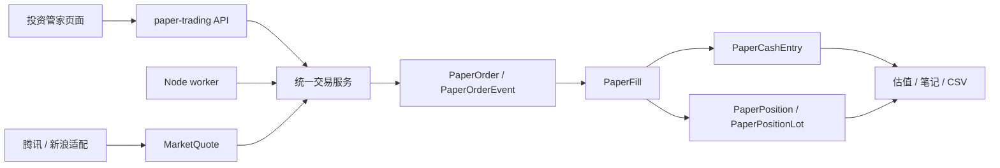

# 模拟交易 MVP：实现记录与运行说明

版本：v0.2  
日期：2026-10-08  
状态：第 4～18 项工程已扩展，隔离与兼容验证通过；市场资料及真实用户验收未全部完成，真实行情撮合默认关闭

关联：[PRD](paper-trading-mvp-prd.md) · [技术规划](paper-trading-technical-design.md) · [第 4～18 项验收矩阵](paper-trading-4-18-acceptance.md) · [AI 策略实验说明](paper-trading-strategy-lab.md) · [二期 TODO](paper-trading-phase2-todo.md)

## 1. 当前可以体验什么

投资管家顶部有 **资产与产品／模拟交易／交易复盘** 三个入口。原有真实资产与产品、投资 Agent 普通对话保持查询职责；普通聊天没有下单权限。AI 策略实验另有经用户确认的执行上下文和程序风控。

- 创建独立的 10 万元模拟账户；账户、现金、冻结和真实财务底账隔离。
- 按名称、拼音或代码搜索受支持证券，查看腾讯报价、买卖一档和不复权日线；加入或移出自选。
- 预览限价单金额与费用，显示所有阻断条件。未完成行情及规则核验时，确认按钮不可用，服务端也拒绝提交。
- 已实现下单、撤单、部分成交、T+1 可卖批次、订单到期、有限盘口撮合、现金和费用流水、加权成本、浮盈和已实现交易盈亏。
- 查看委托、成交、资金流水、实际估值点，按日期筛选，追加复盘笔记，导出完整账户 CSV。
- 归档账户并保留未平仓持仓；可以建立新的账户。彻底删除有影响预览、删除任务与文件清理重试。
- 本地维护入口可以导入有来源的日历、证券状态和核验报告；支持现金分红、送转的预览及人工确认。

**已写入代码、通过合成数据测试，与通过真实市场验收是两件事。当前不能将本版本标为全部 MVP 验收完成。**

新增手动／AI 策略实验／历史回放三种账户用途入口；股票池、策略、授权、条件单、监控、专业复盘及回放时钟都已持久化。当前工程结果为 **84 项模拟交易＋17 项五管家兼容测试通过**，另有迁移及真实子进程可靠性演练。详细范围及未完成条件以[验收矩阵](paper-trading-4-18-acceptance.md)为准，不能据此称真实市场验收已通过。

## 2. 启动与停止

在项目目录中执行：

```sh
node node_modules/prisma/build/index.js generate
node scripts/database-migrate.mjs
node scripts/paper-dev.mjs --hostname 127.0.0.1 --port 3000
```

迁移前停止正在运行的 Web 和 worker。安全迁移会生成备份并核对原财务记录。Web 与 worker 共用同一份 `.env` 的 `DATABASE_URL`，启动器将其解析为绝对路径；没有新增 Python 行情服务依赖。

- `dev:paper` 先用项目已有 TypeScript 编译独立 worker，再一起启动 Web、撮合和策略调度三个进程。关闭终端／Ctrl+C 同时停止这三个进程。
- 已有 Web 时可以单独执行 `node scripts/paper-dev.mjs --worker-only` 启动两个 worker，不要再启动第二个 Web。
- 普通 `pnpm dev` 只启动 Web，不能持续撮合。页面会显示服务未运行。
- 编译产物位于 `.local-data/paper-runtime/`，不会提交到 Git。修改 worker 代码后需要重启启动器；页面和 API 仍使用 Next 热更新。
- 撮合 worker 每 5 秒独立维护心跳，慢网络不阻断续期；15 秒租约及 fencing token 阻止旧进程继续成交或自动推进回放。策略 worker 使用独立 `strategy` 租约，每 10 秒续期；重启后实验暂停待用户恢复。行情按已确认配置轮询。
- 报价失败采用最长 60 秒的退避；不会自动切到未经验证的备用源。

## 3. 实际数据与事务边界



| 数据组 | 实际记录 | 口径 |
| --- | --- | --- |
| 市场资料 | MarketInstrument、MarketCalendar、MarketDailyState、MarketQuote、MarketReviewRecord | 公共资料；日历不以周一至周五自动代替；保留维护输入证据 |
| 规则 | PaperRuleVersion | 发布后不可覆盖；费率、数量、数据质量规则和来源版本化 |
| 账户与订单 | PaperAccount、PaperPreview、PaperRequest、PaperOrder、PaperOrderEvent | 独立版本；预览绑定工作区 epoch；重试优先返回已有结果 |
| 账本 | PaperFill、PaperCashEntry、PaperPosition、PaperPositionLot、PaperQuoteConsumption | 成交和流水不可修改；余额与持仓是可对账投影；报价消耗去重 |
| 复盘与维护 | PaperEquitySnapshot、PaperReviewNote、PaperAdjustment、PaperWatchlist、PaperWorkerLease | 快照保存当时证据；笔记追加；人工调整与原成交分开 |

金额为整数分，数量为整数股。佣金、过户费和卖出税费按订单累计成交额计算，再扣除已计费用，避免部分成交重复收最低佣金。当前默认费用只是试算假设，未当作真实适用费率发布。

网络请求均在写事务之外。每笔撮合使用独立短事务，重新读取订单状态，原子保存成交、费用、现金、冻结和持仓。撤单与撮合按提交先后生效。

应用维护与交易写入使用同一个进程间排他锁；恢复会清除旧租约和预览，提升数据 epoch，并要求重新对账。恢复后不使用重启前的报价补造成交。锁不按时间强行抢占仍存活的进程；只有确认原进程已退出才自动回收。

数据库另外约束同工作区只有一个当前 MANUAL/LIVE 账户、最多一个 RUNNING 实时 AI 实验、跨工作区订单引用、负资金／负持仓、无效订单状态和历史事实不可覆盖。模拟修订不会改变真实画像、资产或规划版本。

新增数据组：

| 数据组 | 记录 | 关联与边界 |
| --- | --- | --- |
| 策略实验 | PaperStrategyExperiment、PaperStrategyVersion、PaperStockPoolVersion、PaperStrategyAuthorization、PaperStrategyRun | 独立 AI 账户；不可将股票池当持仓；运行绑定版本、授权、时间片及证据 |
| 回放训练 | PaperReplayDataset、PaperReplayBar、PaperReplaySession | 独立账户与历史时钟；数据集/规则版本保留；报价与导出截断于模拟时间 |
| 条件单 | PaperCondition | 独立条件与唯一普通子订单；冻结转移不重复；撤销和到期释放 |
| 监控及维护 | MarketSourceHealth、PaperOperationalEvent、PaperReconciliation、PaperMarketDraft、PaperBenchmarkPoint | 来源质量、账本核对、可预检维护草稿、真实基准资料与已确认状态分开 |

全部新增私有记录纳入账户导出、应用备份/恢复及删除传播。共享历史数据集仍有其他账户引用时明确保留，不误删其他账户。恢复撤销授权、暂停实验/回放、清除旧租约/预览，再核对账本。

## 4. 接口

统一前缀 `/api/paper-trading`。需要当前本地工作区的 `X-Workspace-Id`；本地 Host 和 Origin 均校验，不是公开服务身份认证。

| 方法 | 路径 | 能力 |
| --- | --- | --- |
| GET | overview、accounts、positions、orders、fills、cash-entries、equity、reviews | 查询工作区账户及关联状态；可用 accountId 指定历史账户 |
| GET | instruments?q=、quotes?symbols=、bars?symbol= | 搜索、报价、不复权走势；失败和过期分别展示 |
| POST | accounts、accounts/archive | 初始化及版本校验归档 |
| POST | orders/preview、orders、orders/cancel | 预览、幂等提交及撤销剩余数量 |
| POST | watchlist、reviews | 自选、追加笔记；笔记用 key 防重 |
| GET | export、health | CSV 及 worker 心跳 |
| GET/POST | market-review | 查看／确认公共资料及市场规则核验 |
| POST | adjustments/preview、adjustments/confirm | 公司行为预览、版本校验与幂等确认 |
| GET | deletion-preview、deletion-jobs | 删除影响及未完成清理任务 |
| POST | accounts/erase | 确认删除；失败后带 retryId 继续清理 |

查询接口目前服务受控 Demo，订单和流水完整返回，由页面筛选；大规模数据分页和公开服务权限另行建设。

第 4～18 项扩展仍使用同一前缀：

| 能力 | 路径 |
| --- | --- |
| 状态、健康、账户处理与核对 | `status`、`health/detail`、`health/operate`、`health/retry` |
| 订单链路与指标 | `orders/detail`、`history`、`insights`、`reviews/ai` |
| 维护预检与版本确认 | `market-review/preview`、`market-review/confirm` |
| 历史数据与时钟 | `replay`、`replay/preflight`、`replay/import`、`replay/create`、`replay/advance`、`replay/status` |
| 条件单 | `conditions`、`conditions/create`、`conditions/cancel` |
| 实验与策略版本 | `experiments`、`experiments/create`、`experiments/pool`、`experiments/draft`、`experiments/confirm`、`experiments/authorize`、`experiments/pause`、`experiments/archive` |

交易写入必须明确指定账户并核对工作区归属。公开手动入口拒绝 AI 账户；自动交易只接受当前授权运行上下文。历史回放的用户单步与后台推进共用交易服务，后台另在写事务内核对有效租约。AI 和网络均不进入写事务。

## 5. 交易开放前如何核验

### 5.1 采样

```sh
pnpm paper:probe 30
```

在真实连续竞价的上午和下午各执行一次。脚本按 5 秒起点采集两个来源、三个板块各两只股票，写入 `.local-data/market-probes/*.jsonl`；最多单次 60 分钟，不修改账户或自动开启交易。

维护人员据原始记录计算成功率、字段完整率和行情源时间年龄 p95，分别核实：

1. 主板、创业板、科创板数量／价格规则及适用费用。
2. 腾讯及新浪数量单位、源时间、异常值和实际更新频率。
3. 当日证券状态、价格上下限、上市特殊阶段、公司行为覆盖。
4. 完整交易日历，包含当前日到下一交易日之间的休市日。
5. 数据的使用权限及本地 Demo 适用范围。

### 5.2 导入资料

页面“账户与资料维护 → 本地 Demo 行情资料核验”接受 JSON。以下仅示范导入休市日历，不开放交易：

```json
{
  "source": "https://www.sse.com.cn/disclosure/dealinstruc/closed/c/c_20251222_10802510.shtml；人工核对年度休市安排",
  "confirmed": true,
  "calendar": [{ "day": "2026-10-07", "isOpen": false }],
  "states": []
}
```

`states` 每项包含 `instrumentId/day/status/eventCoverage/lowerMinor/upperMinor`。证券先通过搜索登记；状态可为 NORMAL、SUSPENDED、REVIEW_REQUIRED、UNSUPPORTED。金额为分的字符串；不得把未知的公司行为覆盖填为 true。

完成真实验证后才能提交 `rule`，其中：

- `id`：新的不可变版本编号。
- `config`：commissionPpm、minimumCommissionMinor、transferPpm、stampSellPpm、maxAgeMs、pollMs、provider，以及 MAIN/CHINEXT/STAR 各自的 min/step/max、priceCageBps、priceCageMinTicks；qualified、qualifiedUntil、evidence 必须反映真实核验结果。ppm 为百万分之一，minimumCommissionMinor 为分，priceCageBps 为基点，priceCageMinTicks 为最小价格变动单位个数。
- `validation`：morningMinutes、afternoonMinutes、successRate、requiredFieldsRate、sourceAgeP95Ms、mainSamples、chinextSamples、starSamples、reportPath、rulesAndFeesSource、dataUseChecked、sampledOn。
- 验收门槛：上下午各至少 30 分钟；各板块至少两只；成功率 ≥99%；关键字段完整率 100%；源时间年龄 p95 ≤15 秒。

导入是维护人员明确确认的证据记录，程序校验结构与门槛，并不会自行证明报告真伪。不要填写虚构结果使按钮可用。换规则会使已有预览失效；旧挂单保留原规则，存在版本差异时暂停，需用户撤单重提。

## 6. 已执行的验证

2026-10-07：

| 验证 | 结果 |
| --- | --- |
| 金额、累计费用、数量差异、价格笼子、时区、两源解析、CSV 安全 | 8 项通过 |
| 独立账本、跨周末 T+1、部分成交、撤单、并发与幂等、报价阻断、重启不补成交、租约、归档、人工分红、恢复 | 16 项通过 |
| 真实 API、整数金额序列化、Origin 校验、笔记幂等、导出、应用备份恢复、彻底删除旧副本 | 4 项通过 |
| TypeScript 类型检查、独立 worker 编译 | 通过 |
| 局部 ESLint | 无错误；存在复杂度提示，未为消除提示进行无关重构 |
| 安全迁移及既有业务迁移检查 | 通过；原核心财务记录签名一致 |
| 浏览器检查 | 三个入口、账户创建、按名称搜索、历史报价、日线及订单预览已检查 |
| 实际盘中采样、真实行情买卖跨日闭环 | **未完成：当天休市** |

复现自动验证：

```sh
pnpm exec vitest run src/domain/paper-trading.test.ts src/server/paper-trading/service.test.ts src/server/paper-trading/management.test.ts
pnpm typecheck
```

测试创建临时 SQLite，不将合成报价、已验证规则或交易写入用户真实工作区。

10 月 7 日自动验收共 **28 项通过**。浏览器体验检查创建了一份无持仓的模拟账户，其初始资金不计入真实资产。

价格边界实现参考[上交所《交易规则（2026 年修订）》及附件](https://www.sse.com.cn/lawandrules/sselawsrules2025/trade/universal/c/c_20260424_10816492.shtml)：普通主板与科创板分别配置，不把同一数量或价格规则直接套用于全部证券。该项核对不替代深交所规则、适用费率和实际数据源验收。

本次安全迁移应用 `20261007090000_paper_trading`。迁移前后 Asset、Liability、Transaction、Goal、CarFundingReservation、CarPlanVersion 的核心签名均为 `6681f340a73339d1c5355914637f6f405717ca12d08843aa0eaf8a3213e99e9b`。本地报告位于 `.local-data/schema-migration-report.json`，包括迁移前备份编号。

## 7. 当前限制与剩余验收

- 免费来源的完整盘中质量、当日证券状态覆盖及数据使用条件仍待核验，当前不开放真实行情成交。三板块规则和费用的补充核对见下节。
- 日历与公司行为资料使用明确的本地维护入口，尚无自动同步；未提供覆盖资料的股票不能交易。
- 公司行为目前支持人工确认的现金分红与送转。复杂事件及已入账事件更正不得覆盖历史；保持暂停，后续补充有证据的冲正与历史重算流程。
- 下单为手动，AI 不会代替用户提交委托；集合竞价、特殊证券、历史回放、止盈止损和自动策略未启用。
- 资产曲线展示已保存的估值点。缺失或资料不完整时不伪造连续收益。
- Web 和 worker 需要本机持续运行；关闭期间没有成交，也不补成交。
- 彻底删除清理当前模拟账户及应用管理的全部旧备份；应用外 CSV、手工备份不受管理。浏览器不持久化模拟业务缓存，清理成功后刷新内存状态。

完成上述盘中验收和少量真实目标用户试用后，才能把 PRD 的 A01—A15 标为全部完成。

## 8. 2026-10-08：P0 第 1—3 项执行记录

### 8.1 行情质量验证（进行中）

上午采样于北京时间 09:30 开始，计划持续 30 分钟；下午采样进程已安排于 13:00 开始，持续 30 分钟。各轮覆盖腾讯、新浪两源及三个板块各两只股票。采样进程需要本机保持运行及联网，不会自动开放交易。

新增 `scripts/paper-quote-report.mjs`，分别统计来源与时段的成功率、字段完整率、源时间年龄、请求耗时、时间戳更新及采样空档。缺少下午、跨日期拼接或长时间断采均不能通过覆盖检查。报告始终区分质量候选与交易开放。

```sh
node scripts/paper-quote-report.mjs .local-data/market-probes/2026-10-08T*.jsonl
node --test scripts/paper-quote-report.test.mjs
```

本地输出为 `.local-data/market-probes/latest-quality-report.json`；上午、下午进程状态分别保存于 `2026-10-08-morning-status.json` 与 `2026-10-08-afternoon-status.json`。下午进程结束时自动执行汇总。过程中的报告属于阶段结果，不能替代两轮完成后的报告。

已观察到相同证券相同源时间下，腾讯盘口换算为股后为整百股，新浪有零股数量，例如平安银行卖一 98,300 与 98,263 股。这意味着不能把腾讯数量当作精确的可成交容量。新浪报价不提供涨跌停字段，仍需独立市场资料。上述差异尚不构成任何一源全面合格的结论。

### 8.2 规则与费用核对（已完成本轮核对及展示修正）

参考[上交所 2026 年交易规则及附件](https://www.sse.com.cn/lawandrules/sselawsrules2025/trade/universal/c/c_20260424_10816492.shtml)与[深交所 2026 年交易规则](https://investor.szse.cn/lawrules/rule/trade/t20260424_620190.html)，核对普通股票的最小数量、递增数量、单笔上限、价格最小单位与连续竞价有效价格范围。当前实现分别保留主板、创业板、科创板配置；特殊股票及上市特殊阶段不据此放开。

| 费用 | 当前模拟口径 | 依据与性质 |
| --- | --- | --- |
| 佣金 | 万分之三，每笔委托累计最低 5 元 | 产品模拟设定，含经手费和证管费，不代表用户券商报价 |
| 过户费 | 成交额十万分之一，双向 | [券商公开费用表](https://www.tebon.com.cn/main/businessGuide/economicBusiness/zqjyfgs/index.html)核对；保留来源层级 |
| 印花税 | 卖出成交额万分之五，买入不收 | [印花税法](https://fgk.chinatax.gov.cn/zcfgk/c100009/c5193058/content.html)与[2023 年减半征收公告](https://shanghai.chinatax.gov.cn/zcfw/zcfgk/yhs/202308/t468451.html) |

订单预览新增三项费用明细、费率及模拟佣金说明。部分成交仍按委托累计费用计收，避免重复收取最低佣金。新增 1 万元成交额的费用断言：买入 5.10 元、卖出 10.10 元。金额计算结果未因展示拆分改变。

验证结果：业务测试 29 项通过，报告分析测试 4 项通过，TypeScript 检查通过；局部 ESLint 无错误、有 4 项复杂度提示。没有执行与本次修改无关的重构。

### 8.3 首批股票、日历和公司行为（资料已准备，开放仍有缺口）

版本化清单：[六只候选股票及核对证据](data/paper-market-candidates-2026-10-08.json)。包含浦发银行、平安银行、宁德时代、东方财富、中芯国际、金山办公，保存上市日期、公告核对范围、最近分红信息、报价时间与价格边界。

已读取巨潮公司资料、2026-07-01 至 10-08 的 155 条公告标题及当日事项清单。公告标题和当日事项未匹配到候选证券的适用事件，不能据此证明盘中无临时停牌或未知公司行为。原始响应、来源与哈希保存在 `.local-data/market-probes/evidence-2026-10-08/`。

已导入 10 月完整 31 天交易日历，并与[上交所国庆休市通知](https://www.sse.com.cn/disclosure/announcement/general/c/c_20260915_10832273.shtml)交叉核对：10 月 8 日开市，10 月 10 日周六仍休市。已登记六只证券及当日价格边界，但状态保持 `REVIEW_REQUIRED`、事件覆盖保持未确认。导入回执为 `evidence-2026-10-08/import-result.json`，没有发布合格规则或修改真实财务资料。

**剩余开放条件：** 完成上下午采样；确定盘口数量处理口径；补齐可靠的当日及盘中证券状态、公司行为覆盖证据；核实数据使用条件。可访问免费接口并不自动满足这些条件。全部满足后才能发布不可变规则版本，继续真实行情交易闭环验收。
