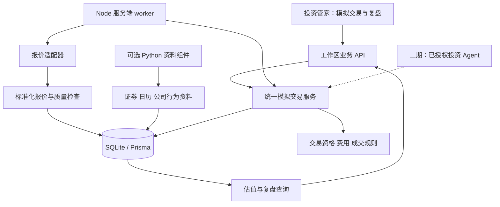
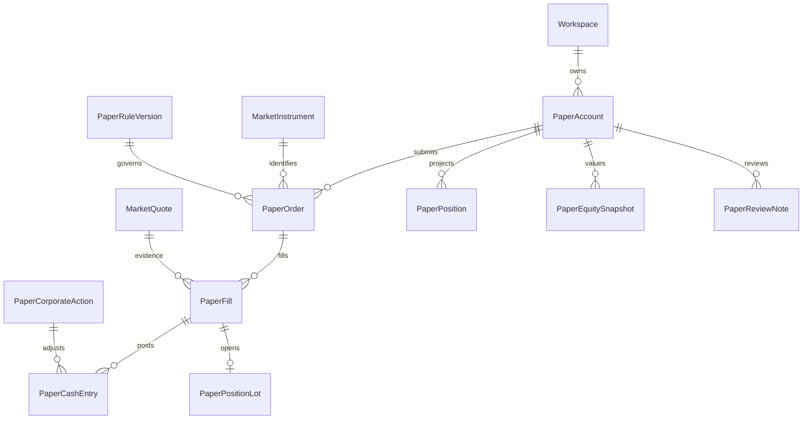

# 投资管家：模拟交易 MVP 技术实施方案

版本：v0.1  
日期：2026-10-07  
状态：需求与技术规划，待实施  
适用环境：现有个人、本地受控 Demo

相关文档：[MVP 产品需求](paper-trading-mvp-prd.md) · [二期 TODO](paper-trading-phase2-todo.md)

实施进度（2026-10-07）：交易服务、后台进程及页面已接入。本文为规划基线，实际模型、接口、已验证内容及剩余门槛见[实现记录](paper-trading-implementation.md)。盘中行情与规则验收尚未完成。


> **2026-10-08 增量状态：** 本文保留 v0.1 规划基线。用户随后将独立 AI 策略实验、历史回放、条件单、监控与分析纳入第 4～18 项本轮交付，当前实现与验收以[第 4～18 项完成矩阵](paper-trading-4-18-acceptance.md)和[策略实验说明](paper-trading-strategy-lab.md)为准。原文的“二期／待实施／手动首版”是此前范围，不代表这些能力目前仍全部未建；原 TODO 不能直接当作本轮完成记录。

## 1. 文档口径与现状

本文定义未来实施边界与验收方式。所有新增模块、实体、接口和运行命令均为拟建能力，不代表已存在。PRD 的 C01—C05 是用户确认需求，D01—D08 是产品建议默认，本文沿用。

### 1.1 已核对的工程基础

| 基础 | 当前事实 | 复用方式 |
| --- | --- | --- |
| 前后端 | Next.js 16.3.5、React 19.2、TypeScript | 在现有投资管家新增模拟交易和复盘入口 |
| 数据库 | Prisma 6.19、SQLite | 增量迁移、新增独立模拟交易表，共用工作区归属 |
| 校验与金额 | Zod 4.1、bignumber.js 11.1、BigInt 最小货币单位 | 复用输入校验、整数金额序列化与确定性计算模式 |
| 投资业务 | 持仓详情关联真实 Asset，已有用途筛选、产品版本及产品意向 | 保留真实业务，模拟持仓不写入 HoldingDetail 或 Asset |
| Agent | 角色工具注册、上下文装配、运行记录与确认提议机制 | 后续包装统一交易服务；首版不注册可由模型调用的下单工具 |
| 数据管理 | 本地备份、恢复预检、数据删除、工作区版本 | 扩展模拟数据覆盖及交易 worker 的停写协调 |
| 验证 | Vitest、TypeScript、ESLint | 按模块局部验证，最终依项目 CI 要求执行必要检查 |

主要接点：`src/components/specialist-managers.tsx`、`src/server/agent-tools.ts`、`prisma/schema.prisma`。其他改动依据实际依赖定位，不重构无关业务。

### 1.2 硬边界

- 手动交易、默认初始资金 10 万元、每工作区一份当前账户、当日限价单、真实交易时间；历史回放属于二期。
- 主板、创业板、科创板按版本化规则支持；ST 等特殊证券不开放，目录可查询与可交易资格分离。
- 模拟资金与真实资产、记账、目标预留不互相入账；使用独立交易修订号，不因行情刷新让真实规划过期。
- 网络、AI、文件导出和备份不进入写事务。金额、成交及盈亏由确定性服务计算。

## 2. GitHub 调研与技术决策

### 2.1 调研方法与边界

2026-10-07 阅读项目 README、许可证和部分源码，通过 GitHub 公共 API 核对维护时间。下表“最近活动”区分默认分支提交与仓库推送；它只能证明活动记录，不能证明生产质量。未安装、运行或完整审计这些交易框架。

| 项目 | 维护与许可事实 | 部署复杂度 | 功能复用性、二次开发适配 | 本期策略 |
| --- | --- | --- | --- | --- |
| [vnpy_paperaccount](https://github.com/vnpy/vnpy_paperaccount) | 默认分支提交 2026-10-05，版本 1.1.1；MIT | 中高：Python ≥3.10、vn.py ≥4.0 | 订单、盘口撮合、持仓可参考；现有引擎接口与 Web、Prisma、A 股资金核算仍需适配 | 不直接集成；留作引擎扩展候选 |
| [hypersupersheep/paper-trading](https://github.com/hypersupersheep/paper-trading) | 默认分支提交 2026-07-07；当次未发现明确许可证 | 低至中：Python HTTP 服务、SQLite、原生 JS | 功能接近需求，含模拟账户、审计及 Agent 接口；与本项目会形成两套账户及状态 | 仅作功能调研；许可未明确前不复制代码 |
| [a-share-quant-sim](https://github.com/fkchaos/a-share-quant-sim) | 仓库推送 2026-10-05；MIT | 中：Python、pandas、numpy、requests，行情仍依赖外部接口 | 共享策略路径、研究与日频模拟盘；用户手动盘中交易需要新增适配 | 二期策略研究候选，不引入其整套运行流程 |
| [RQAlpha](https://github.com/ricequant/rqalpha) | 默认分支提交 2026-09-24，仓库推送 09-28；现行许可区分用途 | 中高：Python 框架及数据适配 | 回测、账户和规则扩展较完整；对本期手动 Web 模拟盘偏重 | 商业授权及接入成本未解决，本期不引入；见[许可证](https://github.com/ricequant/rqalpha/blob/master/LICENSE) |
| [easyquotation](https://github.com/shidenggui/easyquotation) | 默认分支提交 2026-02-28，最近提交为文档；MIT | 低：轻量 Python 行情访问 | 腾讯、新浪报价解析，可取得价格、盘口、时间；需验证接口可用性 | 复用行情适配思路；移植所需 MIT 适配代码时保留许可与归属 |
| [AKShare](https://github.com/akfamily/akshare) | 默认分支提交 2026-09-30，仓库推送 10-07；MIT | 中：Python 数据依赖及多来源访问 | 证券资料、交易日历、历史 K 线及公司行为候选；具体覆盖须逐接口验证 | 按需直接引用，独立资料组件提供统一输出 |
| [mootdx](https://github.com/mootdx/mootdx) | 默认分支提交及推送 2024-07-16；MIT | 中：Python 与通达信协议链路 | 线上行情、历史数据；维护时间较早，Mac 及网络兼容性需验证 | 备用调研，不作为首选源 |

### 2.2 最终策略

采用“现有项目增量开发 + 行情组件复用”。模拟交易服务从零实现受限业务范围；不 Fork 完整交易平台，不另建独立用户体系。

- **直接引用**：已有 Prisma、Zod、bignumber.js；经接口验证后按需使用 AKShare。
- **适配复用**：优先将 easyquotation 的必要报价解析适配到服务端 TypeScript，保留 MIT 声明、上游版本和变更记录；腾讯为首选验证源，新浪为备选。未经验证不自动启用备用源撮合。
- **独立开发**：模拟订单、资金账本、A 股适用性检查、简化撮合、对账、收益和页面。
- **延期评估**：vn.py、RQAlpha 和研究框架用于二期复杂策略需求。

若需要 Python 资料组件，仅负责采集证券、日历、历史及事件资料，通过只读内部 HTTP 接口返回标准化数据；绑定本机，设置超时、服务凭据和来源白名单。Node 服务验证后持久化。Python 不持有业务数据库写权限，不操作账户或订单。

开源许可与数据展示、保存、再分发权限分开核对；读取成功不等于得到公开产品的数据授权。确切费用与授权范围取得依据后再记录，本文不作购买承诺。

## 3. 行情证据与实施前验证

### 3.1 本次休市检查

检查日期 2026-10-07，各源一次请求、每次两个代码 `sh600000`、`sz000001`；未做高频压测。

| 来源 | 结果 | 返回字段与时间 |
| --- | --- | --- |
| 腾讯公开报价接口 | HTTP 200，单次约 250 ms | 最新价、买一、卖一、涨跌停价格；两证券报价时间为 2026-09-30 16:14:54、16:15:00 |
| 新浪公开报价接口 | HTTP 200，单次约 250 ms | 最新价、买一、卖一、日期及时间；两证券报价时间为 2026-09-30 15:34:59、16:30:00 |

依据：[腾讯适配源码](https://github.com/shidenggui/easyquotation/blob/master/easyquotation/tencent.py)、[新浪适配源码](https://github.com/shidenggui/easyquotation/blob/master/easyquotation/sina.py)。原始检查输出留在本次对话，尚未形成独立可重放附件；该结果仅是一次连通性观察。

当天为休市日，[上交所公告](https://www.sse.com.cn/disclosure/dealinstruc/closed/c/c_20251222_10802510.shtml)明确 10 月 8 日恢复交易。本次不能测出盘中行情延迟、刷新频率或持续稳定性。秒级时间戳也不证明秒级更新保证。

### 3.2 第一批必须交付的证据

- 在真实交易日选取三个板块各至少两只正常证券，覆盖上午、下午各至少 30 分钟，先按 5 秒轮询；接口允许且稳定后再比较 3 秒配置。
- 保存脱敏后的来源、证券、请求时间、返回时间、源时间、载荷签名、状态、解析结果、缺失字段与错误。遇到限流或拒绝访问退避，不绕过限制。
- 分别报告请求耗时分位数、源时间年龄、报价变化间隔、失败率、必填字段完整率及来源间差异。与另一免费源一致不能单独证明交易所级真实延迟。
- **建议验收阈值**：样本请求成功率 ≥99%，正常交易样本关键字段完整率 100%，源时间年龄 p95 ≤15 秒；停牌、无报价等情况单独统计且能识别。阈值是 Demo 验收目标，不是数据商承诺。
- 交易报价必须有可信源时间、买卖报价及数量、交易状态或对应独立资料。候选适配器证明不了关键能力时，不接入正式撮合。
- 核实证券目录、板块、状态、交易日历、当日价格限制和公司行为来源。行情连通通过不代表这些资料也已通过。
- 输出配置报告：启用来源、覆盖范围、刷新间隔、时效阈值、退避策略、限制和复测日期。未通过时保持交易未开放，不能悄悄改为收盘价成交。

初始工程参数建议为 5 秒轮询、交易报价最大源年龄 15 秒、缓存读取最大年龄 10 秒；三个参数均待交易时段验证。新单预览有效期建议 30 秒；确认仍重新检查实际可用报价。

## 4. 架构与模块



| 模块 | 责任 |
| --- | --- |
| MarketData | 搜索目录、自选、报价标准化、交易日历、资料质量、来源切换 |
| RuleRegistry | 板块申报规则、费用、成交政策、时效配置的不可变发布版本 |
| PaperAccount | 初始化、资金余额投影、冻结资源、归档及独立修订号 |
| OrderService | 预览、提交、撤销、到期及来源审计 |
| Matching | 符合条件的报价事件驱动成交，分配可见数量 |
| Ledger | 成交、费用、公司行为调整的资金与数量事实，更新可重建投影 |
| Valuation / Review | 成本、盈亏、快照、历史查询、笔记及导出 |
| Worker / Maintenance | 调度、租约、恢复、对账、维护模式与健康状态 |

## 5. 数据模型与关系

以下为拟建逻辑实体；后续迁移使用独立 `Paper*` / `Market*` 命名。公共市场资料不属于个人工作区，个人交易记录必须带工作区归属。

| 实体 | 最小数据及关系 |
| --- | --- |
| MarketInstrument | 市场＋代码唯一，名称、板块、上市日期、状态、来源、有效日及核对时间 |
| MarketCalendar | 交易所、交易日、各阶段及特殊休市，来源与版本；不能只按周一至周五生成 |
| MarketInstrumentState | 证券日状态、停复牌、上下限、公司行为覆盖范围、规则引用和核对状态 |
| MarketQuote | 证券、来源、源时间、获取时间、原始载荷签名、现价及盘口、质量；成交引用的标准化快照不可覆盖 |
| MarketBar | 证券、周期、时间、不复权 OHLCV、来源和质量；与成交报价分开 |
| PaperRuleVersion | 交易规则、费用、成交与质量配置，来源、有效区间、确认人、内容签名；已发布版本不可覆盖 |
| PaperAccount | 工作区、当前或归档、初始资金、现金及冻结投影、独立版本、核对状态、规则版本、归档末值与时间 |
| PaperWatchlist | 工作区、证券及排序；不保存另一份价格 |
| PaperOrder | 账户、证券、买卖、LIMIT、DAY、限价、数量、累计成交、累计费用、剩余冻结、状态、规则与预览引用、来源 MANUAL |
| PaperOrderEvent | 提交、撤销、到期、拒绝、恢复处理等不可变事件；记录原因及版本 |
| PaperFill | 订单、证券、成交数量和价格、费用明细、交易日、所用报价及规则版本、唯一成交键 |
| PaperCashEntry | 账户、初始资金/买入货款/卖出收入/费用/核实调整，带符号金额、成交或调整引用、账户序号及结果余额 |
| PaperPosition | 账户＋证券唯一；数量、冻结、总成本和版本，属于投影；不能独立编辑余额 |
| PaperPositionLot | 买入成交批次、剩余数量、可卖交易日；用于 T+1 数量检查，加权成本在持仓层核算 |
| PaperQuoteConsumption | 账户、证券、报价、方向、已消耗数量；阻止重复快照无限撮合 |
| PaperEquitySnapshot | 账户、估值日期与时间、现金、市值、成本、收益、覆盖率及质量，引用证据和修订来源 |
| PaperReviewNote | 工作区、账户、可选订单或周期、笔记及修改历史；下单原始理由保存在订单 |
| PaperCorporateAction | 证券事件来源、权益登记与生效日、适用批次、账户调整、人工确认及幂等键；未知可只存待核对事件 |
| PaperRequest / PaperPreview | 命令幂等键及请求签名/返回结果；预览参数、规则、账户版本、有效期、使用状态 |
| PaperWorkerLease / PaperServiceEvent | worker 持有者、租约、心跳、维护状态、epoch、停机及恢复区间 |



### 5.1 数据库不变量

- 个人表提供 `(workspaceId, id)` 复合唯一键；订单→账户、成交→订单、流水→成交、笔记→账户/订单使用带工作区的外键，所有账户引用还须一致。
- 一工作区仅一个当前账户，通过条件唯一索引兜底；暂停核对仍属于当前账户。归档和新建在同一事务内串行完成。
- 金额、冻结和持仓数量满足非负边界，冻结不超过相应余额或数量；累计成交不超过委托数量。明确 CHECK/触发器及服务层校验的分工。
- 账户命令唯一键包含工作区、账户、命令类型和幂等键。相同键不同载荷返回冲突，不重放另一笔交易。
- 成交、流水序号、公司行为调整键和报价消耗有唯一约束。共享行情与规则以真实外键关联，不虚构工作区。
- 资金流水与成交为事实，余额和持仓为可重建投影。归档保留历史；彻底删除通过数据管理流程处理。

## 6. 金额、费用与盈亏

### 6.1 精度

- 首版人民币，金额与 A 股价格用 BigInt 分，股数用整数；API 的金额统一十进制字符串，禁止 JSON 浮点表示货币。
- 百分比费率用整数分子/分母，计算使用整数或现有十进制库；费用按组件累计成交额计算后四舍五入到分，半分向上。
- 费率、最低收费、适用方向和规则来源必须配置齐全。规则核对未完成时不能用零费率代替未知值。
- 示例费用仅供算例。正式试用的税费及板块规则由 B0 形成来源明确的版本；佣金属于展示并确认的模拟假设。

### 6.2 部分成交与冻结

- 单笔订单按累计成交额计算累计应付费用；本次费用增量＝本次累计费用－此前已记费用。最低佣金在有成交的整笔订单上只应用一次；零成交撤单不收费。
- 买单初始冻结＝限价×委托数量＋该金额下费用上界。成交后重新计算“剩余限价货款＋从已付费用到最大可能累计费用的差额”，释放价格改善及不再需要的部分。
- 卖单冻结可卖数量；费用从实际卖出收入扣除。若净收入不足以覆盖费用，预览和提交同时检查并冻结额外现金上界；不允许扣出负余额。
- 完成、取消或到期时，释放剩余冻结；资金冻结变动写订单事件，不伪装成真实现金收支。

### 6.3 成本与收益

- 买入成本增加成交货款＋买入费用。加仓以总成本/数量得到展示均价，计算不使用已舍入的展示均价。
- 卖出成本按卖出前总成本×卖出数量/总数量结转，按分舍入；清仓结转全部剩余成本。数量批次按最早可卖优先扣减，不能卖出仍未解锁批次。
- 卖出已实现盈亏＝货款－卖出费用－结转成本。浮动盈亏＝有效市值－剩余成本。
- 无公司行为及新增资金时，累计盈亏＝总资产－初始资金＝已实现盈亏＋浮动盈亏。公司行为后另列权益收入、税费与成本调整，仍须对上总资产变化。
- 区间收益只使用真实可用的起止快照。日内当前估值按报价更新，持久化账户创建、成交/调整事件及每日收盘快照；缺失收盘证据时记缺失，不延用旧价伪造当日点。
- 存在未核实权益或关键估值缺失时，收益率返回空值和原因；可以展示有日期的已知金额及覆盖范围，但不能合成确定总收益。

## 7. 最小接口与数据契约

拟用前缀 `/api/paper-trading`，工作区从现有受控上下文校验，不能仅信任请求里的 ID。所有个人查询分页，返回账户版本、估值时间与质量。错误使用稳定错误码和用户可读原因。

| 方法及路径 | 输入与输出职责 |
| --- | --- |
| POST /accounts | 幂等键；按系统默认创建账户，返回初始资金与规则信息 |
| GET /accounts/current | 当前账户、余额、独立版本、运行及核对状态 |
| GET /accounts | 当前及归档账户列表 |
| POST /accounts/:id/restart | 旧账户版本、明确确认、幂等键；撤销剩余订单、归档并新建，保留旧持仓末值 |
| GET /instruments | 代码/名称、市场或板块、游标；返回资格及排除原因 |
| GET /quotes | 有界证券列表；返回标准化报价、双时间、来源及质量 |
| GET /bars | 证券、日期区间、日线周期；返回不复权走势及口径 |
| GET/PUT /watchlist | 查询或确认自选集合，校验版本和证券存在性 |
| POST /orders/preview | 账户、证券、方向、限价分字符串、股数；返回预览 ID、预计占用、费用、理由及有效期 |
| POST /orders | 预览 ID、账户版本、可选原始理由、幂等键；重检后返回委托与状态 |
| POST /orders/:id/cancel | 订单版本、幂等键；取消未成交部分并返回最终状态 |
| GET /orders、/fills、/cash-entries | 账户、日期、证券、状态及游标；可下钻引用证据 |
| GET /positions、/equity | 账户；数量、成本、解锁日期、估值、盈亏与覆盖质量 |
| GET /reviews、POST /reviews、PATCH /reviews/:id | 账户、周期或订单、笔记；修改需要版本，保留历史 |
| GET /corporate-actions、POST /corporate-actions/:id/preview、POST /corporate-actions/:id/confirm | 仅本地维护入口；查询待核对事件、按来源预览受支持调整，校验版本与幂等后确认，写调整与审计 |
| GET /exports | 账户、日期、订单/成交/流水类型；生成带模拟标记、来源及质量的 CSV |
| GET /health | 来源健康、worker 心跳、待核对事件数、当前可交易状态 |

- 400/422：格式、规则或资格不满足；409：版本冲突、相同幂等键不同请求、预览过期；503：行情或交易进程不可用。非法归属统一不泄露他人记录。
- 页面提交的价格只表示限价，不能决定成交价格；费用、时间、账户和盘口全部由服务端取证。
- 预览无资金副作用；确认时行情变化，但委托限价仍在有效申报范围且资源足够，可提交原委托，不要求此刻已经满足成交条件。改变价格、数量、费用规则或资源不足时要求重新预览。
- 请求重试必须先查询幂等结果，再判断版本是否过期；否则第一次已成功的命令会错误报告失败。
- 未来交易调用方共用服务方法并记录 actor/run/strategy 来源；首版 API 仅接受 MANUAL 来源，不凭客户端字符串开放 Agent 权限。

## 8. 交易状态与事务

### 8.1 订单状态

```text
提交 → OPEN → PARTIALLY_FILLED → FILLED
         ├──────────→ CANCELLED（可能已有部分成交）
         └──────────→ EXPIRED（可能已有部分成交）
业务规则拒绝 → REJECTED
```

取消、到期后保留 `filledQuantity`，页面据此显示“部分成交后撤销/到期”。行情暂停或午休使用等待原因，不将所有订单改为终止状态。明显格式错误不创建订单；通过基本解析后的业务拒绝保存可追溯事件。

### 8.2 提交

事务外读取账户及规则，获取并检查行情和资料；生成预览。用户确认后，短事务内校验工作区、dataEpoch、幂等、账户版本、时段、预览与规则版本、报价时效及资源，写入订单、冻结与事件并更新账户版本。事务内不重新发起网络请求。

### 8.3 成交

worker 读取新行情后执行确定性检查，短事务内重新检查租约 fencing token、维护状态、账户与订单版本、报价和剩余资源；同时写成交、费用与资金流水，更新持仓、买入批次、冻结、订单及报价消耗。任一步失败则全部回滚。

撤单与撮合通过条件更新和事务串行化，先提交者生效。已成交数量不能被撤销；冲突时重新读取实际状态返回，不猜测成功。

## 9. 首版模拟成交政策

政策版本 `PAPER_L1_LIMIT_V1`，是产品简化规则，不宣称复制交易所排队。

1. 校验交易日和连续竞价阶段、证券资格、当日状态、公司行为覆盖、账户核对状态及规则有效性。
2. 只使用提交后取得的合格新报价：获取时间晚于接单时间，源时间不早于接单所在秒；来源时间或未来时间异常则拒绝。禁止凭提交前缓存立刻制造成交。
3. 买单限价不低于有效卖一，卖单限价不高于有效买一，才进入数量判断；实际成交价为对应盘口价。
4. 数量最多为剩余委托量与该快照剩余可见对手量的较小值，按适用成交数量精度处理；申报最小数量与部分成交数量规则分开。
5. 同一账户同证券同方向挂单按接单序号分配快照数量；同一快照不得重复分配。不同模拟账户视为独立实验，不竞争真实市场流动性。
6. 报价去重键包含来源、证券、源时间与规范化载荷签名；获取时间变化不产生新额度。源时间推进的新快照允许重新观察可见数量，但仍无法证明是真实新增流动性，该局限保留在成交说明中。
7. 涨停买入、跌停卖出首版保守不撮合；其他方向只有存在有效对手盘口并符合规则时才可处理。无有效量、空盘口、停牌或资料未知均不成交。
8. 来源切换停止处理旧源尚未提交的报价事件，保留已提交成交及报价消耗记录；新源必须通过健康检查并提供切换后及接单后的新报价。不能回退行情时间。
9. 当日未成交部分到期；以市场收盘时点终止，不在收盘后用最后报价继续填单。停机跨日恢复先到期再处理新报价。

盘口只观察第一档，不通过多次轮询声称还原逐笔成交、队列或市场冲击。市场规则核对和撮合政策分别版本化。

历史订单的规则快照不可覆盖；若当前生效市场规则与挂单不再兼容，暂停该单并提示撤单重提，不继续按已失效规则成交。

## 10. 运行、异常与公司行为

### 10.1 服务端 worker

- 新增独立 Node worker 入口，与 Web 同一工程、数据库及业务服务；开发和本地试用由统一启动方式拉起 Web 与 worker，停止时可一起退出。
- 禁止在页面组件、浏览器定时器或每个 HTTP 请求中启动撮合循环；报价获取按共享关注集合批量处理。
- SQLite 保存唯一有效租约及递增 fencing token；租约到期可接管，但旧 worker 提交时必须被 token 拒绝。重复启动不能双重成交。
- worker 负责报价更新、订单到期、交易日切换、资料门槛、快照、异常队列和核对。状态页显示心跳、行情年龄、错误与停机区间。
- 首版要求本机服务持续运行；二期才建设全天候部署、进程托管和独立监控。

### 10.2 重启与恢复

启动先进入 RECOVERING：检查迁移、账本投影、冻结、订单日期、交易日历及事件覆盖，过期单释放冻结；通过后才撮合。同日有效单保留，等待恢复后取得的合格新报价。不回放停机期间价格，不推断“本来应该成交”。

数据库恢复必须暂停 Web 写入及独立 worker，使用数据库可见维护状态与跨进程停写握手；不能仅依靠现有进程内锁。维护租约恢复策略须防止崩溃后旧 worker 重新写入。恢复后提升 epoch、使旧预览失效、清除旧 worker 租约并重新对账。

### 10.3 公司行为最低能力

- 每个交易日前确认持仓与订单证券的当日状态、已知事件及资料覆盖，缺少覆盖按未知处理，不能把“没有接口返回”当成“没有事件”。
- 有分红、送转等事件但无可执行规则时，受影响证券进入 REVIEW_REQUIRED，停止新交易和撮合；保留撤单能力。
- 人工维护入口基于来源、登记日权益持仓、支付或生效日期及调整明细生成预览，明确确认后一次性提交，并保存来源和核对人。现金分红与新增股票分别入账，不改旧成交。
- 对不支持的配股、退市或复杂税费事件，保持暂停及不完整收益状态；不得让用户随意改余额绕过事件。可以归档账户保留已知末值。
- 事件更正生成冲正与新调整，重算受影响快照并保留修订历史；事件键及修订号防止重复记账。

## 11. 数据管理、导出与隔离

- 新表通过增量迁移接入现有备份。迁移前快照与完整性检查，迁移后确认真实资产、流水、目标预留和生效方案不变。
- 归档不删除交易事实。账户彻底清除需预览订单、流水、快照、笔记、审计、派生文本和受管理备份的影响，复用现有删除任务并扩展实体依赖。
- 清除期间停止相关交易写入、清理浏览器业务缓存；受管理备份处理失败时任务未完成。公开市场资料无个人引用时可保留，个人交易关联快照及原始理由必须清除。
- 导出明确“模拟”，包含版本、时区、估值日期与质量；对用户文本做 CSV 公式注入防护。应用外导出文件列为不受管理副本。
- 独立恢复环境不启动自动撮合、不请求实时行情、不复用生产租约。验证完整性、外键、账户对账和历史查询后才允许手动恢复运行。
- 当前按本地工作区边界实现，公开多人服务的身份认证和授权另设发布门槛，不能把传入 workspaceId 当作公开服务权限证明。

## 12. 实施批次与交付门槛

| 批次 | 前置依赖 | 产物 | 完成标准 |
| --- | --- | --- | --- |
| B0 行情与规则验证 | 交易时段、候选来源 | 数据探针记录、接口契约、板块/费用/公司行为来源矩阵、版本化配置 | 三板块正常证券通过；刷新频率和质量可解释；关键资料缺失可阻断；不通过不开放交易 |
| B1 账户与账本 | B0 契约、现有迁移基础 | 新数据表、初始化、冻结、成本与费用函数、幂等、归档、对账 | A01、A05、A08、A10、A12；合成行情仅用于测试，标明非真实交易 |
| B2 手动交易闭环 | B1、通过验证的规则与源 | 报价适配、下单撤单、撮合 worker、持仓页、异常状态 | A02—A07、A09、A11；三个板块闭环，浏览器关闭不停止服务端撮合 |
| B3 复盘与维护 | B2 | 估值与曲线、笔记、导出、公司行为核对入口、数据管理接入 | A13—A15；可重建收益，未知不被填零或伪造成完整曲线 |
| B4 整体验收 | 前四批 | 验收记录、已知限制、试用说明及恢复演练 | 全部 A01—A15、原投资页面与真实财务回归通过，才能标记 MVP 完成 |

B0 的未验证数据能力留在前置核对清单，不能当作二期可选优化。未经实测不填写上线日期或承诺实时服务等级。

## 13. 测试与验收映射

| 层级 | 核心验证 | PRD 场景 |
| --- | --- | --- |
| 纯函数 | 三板块数量/价格政策、交易日与可卖日、费用累进、冻结上界、加权成本、尾差、收益算例 | A02、A04—A08 |
| 数据库 | 成交原子性、并发超买超卖、撤单竞争、相同请求重放、跨工作区外键、同快照去重 | A01、A05—A07、A10、A12 |
| 行情契约 | 手/股和时间转换、缺失值、重复时间、乱序、过期、限流、切源及停牌识别 | A02、A07、A09 |
| worker 恢复 | 双 worker fencing、进程崩溃、提交后响应丢失、午休、跨日启动、维护模式、旧 epoch 拒绝 | A04、A10、A11、A15 |
| 会计与事件 | 多批次买入和卖出、最低佣金一次、分红送转待核对、事件冲正、曲线缺失、归档末值 | A06、A08、A13—A15 |
| 界面与回归 | 从搜索到复盘闭环、模拟标记、交易状态解释、真实资产及现有产品页面不被混入 | A01—A03、A09、A12、A14 |

测试分为固定时钟与合成数据的确定性测试、真实交易日的接口契约检查。休市不能用合成数据冒充实时源验收通过。模拟引擎可自动验证跨日，试用仍需保留真实数据闭环证据。

## 14. 未来 Agent 接口边界

预留服务层能力：读取账户、行情、持仓和历史，预览、提交、撤销订单。接口将来接受已验证的执行主体、授权版本、策略和运行引用；首版仅 MANUAL。

AI 自动模拟交易启用前必须完成资金及证券范围授权、策略版本、频率与风险限制、运行恢复、停止开关和逐单证据。模型不直接写数据库余额，不自行解除规则。自动交易调度可以与撮合 worker 分离，避免模型延迟占用交易事务。详见[二期 TODO](paper-trading-phase2-todo.md)。

## 15. 参考资料与未解决事项

核对日期统一为 2026-10-07；实际实施时再次检查上游变化。

- [AKShare 股票接口](https://akshare.akfamily.xyz/data/stock/stock.html)：验证目录、历史、报价及公司行为覆盖，不假设所有接口都稳定。
- [Tushare 实时分钟](https://tushare.pro/document/2?doc_id=374)：付费或单独权限路线候选，当前不引入、不承诺费用。
- [上交所交易规则及暂缓实施条文](https://www.sse.com.cn/lawandrules/sselawsrules2025/trade/universal/c/c_20260424_10816492.shtml)、[深交所交易规则](https://docs.static.szse.cn/www/lawrules/rule/trade/W020260424690713155663.pdf)：B0 须核对具体板块、交易时段与生效规则，不能只读总则。
- 本期未验证：实际盘中更新频率、限流与稳定性、全部板块状态字段、公司行为覆盖、适用税费、公开数据使用授权。逐项交付要求见[二期文档中的 MVP 前置验证清单](paper-trading-phase2-todo.md)。
- 本文不包含已执行的数据库迁移、依赖安装或功能测试结果；后续验收记录应另行生成并回链到本方案。
