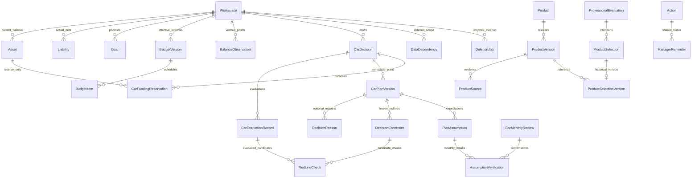

# AI 资产管家统一数据库 v0.3：实现说明与数据字典

日期：2026-10-04。范围：个人、本机受控 Demo；SQLite + Prisma 6.19。

## 1. 技术决策

采用直接引用与增量扩展：复用现有 Prisma、SQLite 和既有计算模块，不引入另一套财务账本或 Agent 框架。

| 方案 | 维护及部署 | 复用价值 | 本期决定 |
| --- | --- | --- | --- |
| [Prisma 官方项目](https://github.com/prisma/prisma) | 官方持续维护；现有工程已安装并使用，增加迁移即可 | 类型查询、事务、外键与增量迁移 | 直接引用，沿用现有版本 |
| [SQLite 备份接口](https://www.sqlite.org/backup.html) | 本机已有 Python 3 的标准库 sqlite3；无需安装服务 | 使用一致性备份，避免直接复制活跃数据库 | 直接引用 |
| [SQLite 外键](https://www.sqlite.org/foreignkeys.html) | 单库适合受控 Demo；云端迁移另设门槛 | 复合外键和触发器兜底 | 增量扩展，不 Fork 数据库 |

运行依赖为现有 Node 环境和 Python 3。备份、恢复及文件清理在事务外执行；AI 不进入写事务。仍有模型处理时拒绝开始删除或恢复，避免旧生成内容在清理后重新写入。

## 2. 事实与历史的关系

- `Asset.currentValueMinor` 是资产金额唯一计算来源；核对历史不是另一份余额账本。
- `Liability` 保存实际负债。贷款候选不创建实际负债，产品意向不创建资产或保单。
- `RecordRevision` 保存修改历史；`CarPlanVersion`、评估及产品比较保存当时快照。
- 金额使用 BigInt 分，API 传十进制字符串。比例阈值使用基点，10000 表示 100%。
- 未知用空值和确认状态表达，不能用默认零代替。迁移余额为未确认基线，不制造过去月份的趋势。
- 没有家庭成员表。新增保单对象仅为本人；旧被保险人原文保留为历史资料。

## 3. 核心关系图

## 4. 决策记忆

`PlanSnapshot` 复用现有 `CarPlanVersion`。理由、红线、预期、事实核对分表保存。

### 理由

六类：KEEP_ASSET / KEEP_SPENDING / AVOID_DEBT / TIME_FIRST / AMOUNT_FIRST / OTHER。分类和原文可分别填写；保留资产类别关联真实资产。未填写不创建理由，采纳快照标记 NOT_PROVIDED。旧系统默认说明不被迁移为用户动机。

### 红线

CURRENT 为当前已确认规则，可在首次采纳前使用；SNAPSHOT 为采纳时的副本，继承来源通过真实外键关联。修改创建新规则，旧规则 SUPERSEDED，旧方案保留。

程序支持不新增负债、不动指定资产、不动目标资金、保护储备、最低流动资金、全部债务还款收入比上限。资料不足为 UNDETERMINED；手工规则为 SKIPPED_MANUAL。违反或未知项不能采纳；手工项必须逐项确认。每条检查关联评估、候选和约束。独立理财筛选也读取相关红线，保留检查结果。

### 假设

定义保存预期、规则和生命周期；逐次核对保存期间、实际金额、实际日期、证据、核对人、时间和更正历史。PENDING / CONFIRMED / FAILED / OVERDUE 与 ACTIVE / SUPERSEDED / REDACTED 分开。

月度假设按月份产生记录；逾期未核对仅产生提醒。确认失效产生幂等影响行动和影响分析摘要，用户核对并重新计算后才能改变生效方案。实际数据注明用户声明，不冒充银行验证。旧假设保持待核实。

## 5. 预算与余额

北京时间自然日、左闭右开。确认当天生效；历史修订须显式确认。同日更正保留 SUPERSEDED 版本，月中修改结束旧区间并开启新区间；数据库拒绝重叠。

日常消费仅计入已接受的消费调整，按有效天数分段汇总后统一舍入；已含还款或保费先扣除其月度预算口径，再按实际约定日期归属固定缴费。年度保费不按天摊分为实际缴费。收入按到账安排，固定缴费、债务和一次性费用按日期归属。日期缺失、预算空档明确展示未知；不填零。预算版本保留当时条目和保费月均口径，不读取今日保单替换历史基准。

复盘先确认规划使用的资产和负债真实余额；不一致时先更新底账。未确认关键账户可保存待核对记录，但不能完成确定性判断或关闭复盘行动。底账确认、逐项确认和复盘会产生真实核对点。

## 6. 专业资料与产品

- ManagerState 三个旧业务 JSON 迁出并清空，数据库阻止迁移后重新写入。保留字段用于兼容检查，后续迁移再删除。
- 预算进入 BudgetVersion/BudgetItem；专业需求进入 InsuranceNeed/InvestmentNeed；版本使用 Workspace.professionalRevision。
- 页面运行状态不参与专业业务签名。买车和情景推演草稿保存在 BusinessDraft，带版本校验；浏览器只保留空间及界面定位。
- 保单和持仓保留原 JSON，同时提供查询字段、来源、历史和 ProductVersion 关联。附件原文不长期保存；来源说明、人工核对信息和可选 SHA-256 哈希只用于一致性核验。
- 12 款静态真实产品初始化为产品身份、发布版本和来源。发布版本不能修改；整理新草稿，确认后发布。旧比较及选择保留原版本。停用后不重新自动启用。

## 7. 事务和隔离

读取资料及版本 → 事务外 AI/计算 → 待确认草稿 → 短事务校验 → 生效方案、预留、结构化行动。

复合外键覆盖预留到资产/决策、决策记忆到资产/目标/继承源、产品意向到评估、提醒到行动、核对到假设和检查到评估。方案、复盘的空间归属通过其决策并由触发器核验。全局产品库没有个人工作区。

触发器补充预算重叠、约束类型/阈值/单位、候选评估互斥、不可变定义、发布资料不可变及运行状态禁止业务写入。SQLite 重建表的迁移明确先移除并重建全部原有触发器。

## 8. 彻底删除

归档保留历史；彻底删除先预览、确认，再建立可重试任务。

当前采用保守传播：目标记录清空金额和内容，整个工作区中可能包含其资料的方案、评估、AI 文本、复盘、对话、偏好、预算副本、草稿、导入记录及来源清除或 REDACTED。原始其他账户保留；预留停止，依赖行动关闭，方案显示资料删除后解释不完整。

DataDependency 保存生成记录引用的实体与版本。旧 JSON 和 AI 文本难以可靠局部清理，因此在预览中告知扩大范围。不能同时保留完整历史解释与彻底清除原资料。

文件阶段清理本机受管理备份，清理 WAL 并压缩数据库，再建立清理后的新备份。文件失败保留 FAILED，可重试；未完成不报告成功。数据纪元变化触发浏览器业务缓存清理。应用外导出、手工旧备份及已关闭浏览器缓存明确为无法远程管理范围。

## 9. 备份、恢复与迁移

- 每日最近 7 份、迁移前最近 3 份；手动备份明确保留。
- 应用打开时检查当日备份；关闭期间无新备份。公开服务前需独立定时任务。
- 使用 SQLite backup 接口；权限 0600，目录 0700，SHA-256 校验。
- 恢复先检查完整性、外键、迁移版本及全库影响，再确认。恢复前保存当前备份，失败恢复原库；纪元及底账、流水、专业资料修订号始终递增，决策与草稿版本同步失效，避免恢复旧值漏清缓存或误接收恢复前的请求。
- 旧结构备份不直接写入新结构在线恢复；须停应用、隔离复制后通过迁移升级。原备份保留。

停止本机预览后执行 `npm run db:migrate:safe`。该工具依次预检、备份、结构迁移、业务迁移及财务一致性核验。报告存 `.local-data/schema-migration-report.json` 与 `.local-data/business-migration-report.json`；均不进入版本库。

迁移失败应保留迁移前备份并停应用；不得用 db push 抹平失败记录。迁移不能伪造旧理由、假设核对、确认优先级或历史余额点。无法解析的原文进入修改历史和迁移核对清单。

## 10. PostgreSQL 预留

BigInt 分、自然日字符串、实体身份、版本和复合外键保持可移植。切换数据库时将 SQLite 区间触发器替换为 PostgreSQL 排斥约束，将不可变与规则触发器转换成对应实现；备份恢复改用目标数据库机制。既有事务版本校验继续保留。本期未开放公开服务权限与交易能力。

## 11. 字段字典

以下按 Prisma 实际模型列出关键持久化字段；关系对象不重复列为列。完整约束以 prisma/schema.prisma 与增量迁移为准。

### Workspace

| 字段 | 类型 | 默认与约束 |
| --- | --- | --- |
| id | String | @id @default(cuid()) |
| professionalRevision | Int | @default(0) |
| businessMigratedAt | DateTime? | — |
| dataEpoch | Int | @default(0) |
| portfolioRevision | Int | @default(0) |
| transactionRevision | Int | @default(0) |
| ledgerConfirmedAt | DateTime? | — |
| ledgerHeadersJson | String | @default("{}") |
| promptOverridesJson | String | @default("{}") |
| multiGoalConsentAt | DateTime? | — |
| createdAt | DateTime | @default(now()) |
| updatedAt | DateTime | @updatedAt |

### Asset

| 字段 | 类型 | 默认与约束 |
| --- | --- | --- |
| id | String | @id @default(cuid()) |
| workspaceId | String | — |
| goalId | String? | — |
| type | String | — |
| name | String | — |
| currentValueMinor | BigInt | — |
| currency | String | @default("CNY") |
| liquidityLevel | String | — |
| riskLevel | Int | — |
| isInvestable | Boolean | @default(true) |
| isAdjustable | Boolean | @default(true) |
| classificationSource | String | @default("RULE_FALLBACK") |
| classificationVersion | String | @default("asset-classifier-v0") |
| source | String | @default("USER_INPUT") |
| asOf | DateTime | @default(now()) |
| deletedAt | DateTime? | — |
| createdAt | DateTime | @default(now()) |
| updatedAt | DateTime | @updatedAt |

### Liability

| 字段 | 类型 | 默认与约束 |
| --- | --- | --- |
| id | String | @id @default(cuid()) |
| workspaceId | String | — |
| type | String | — |
| name | String | — |
| outstandingBalanceMinor | BigInt | — |
| isInstallment | Boolean | @default(false) |
| monthlyPaymentMinor | BigInt | @default(0) |
| remainingMonths | Int? | — |
| totalRepaymentMinor | BigInt? | — |
| principalMinor | BigInt? | — |
| interestMinor | BigInt? | — |
| repaymentMethod | String? | — |
| source | String | @default("USER_INPUT") |
| asOf | DateTime | @default(now()) |
| deletedAt | DateTime? | — |
| createdAt | DateTime | @default(now()) |
| updatedAt | DateTime | @updatedAt |

### Transaction

| 字段 | 类型 | 默认与约束 |
| --- | --- | --- |
| id | String | @id @default(cuid()) |
| workspaceId | String | — |
| direction | String | — |
| amountMinor | BigInt | — |
| occurredOn | DateTime | — |
| description | String | — |
| category | String | — |
| specialKind | String | @default("NONE") |
| analysisTreatment | String | @default("COUNT") |
| source | String | @default("MANUAL") |
| classificationSource | String | @default("FALLBACK") |
| deletedAt | DateTime? | — |
| createdAt | DateTime | @default(now()) |
| updatedAt | DateTime | @updatedAt |

### Goal

| 字段 | 类型 | 默认与约束 |
| --- | --- | --- |
| id | String | @id @default(cuid()) |
| workspaceId | String | — |
| type | String | — |
| name | String | — |
| targetAmountMinor | BigInt | — |
| targetAmountSource | String | @default("USER_INPUT") |
| targetDate | DateTime | — |
| preparedAmountMinor | BigInt | @default(0) |
| monthlyContributionMinor | BigInt | @default(0) |
| priority | Int | @default(2) |
| priorityNote | String? | — |
| priorityConfirmedAt | DateTime? | — |
| isFlexible | Boolean | @default(false) |
| source | String | @default("USER_INPUT") |
| asOf | DateTime | @default(now()) |
| deletedAt | DateTime? | — |
| createdAt | DateTime | @default(now()) |
| updatedAt | DateTime | @updatedAt |

### CarDecision

| 字段 | 类型 | 默认与约束 |
| --- | --- | --- |
| id | String | @id @default(cuid()) |
| workspaceId | String | — |
| goalId | String? | — |
| status | String | @default("DRAFT") |
| version | Int | @default(1) |
| sourceRevision | Int | @default(0) |
| factsJson | String | — |
| conversationJson | String | @default("[]") |
| resumeKey | String? | @unique |
| goalSessionId | String? | @unique |
| viewStage | String | @default("facts") |
| dependenciesJson | String | @default("{}") |
| fieldEvidenceJson | String | @default("{}") |
| evaluationJson | String? | — |
| activePlanId | String? | — |
| purchaseJson | String? | — |
| createdAt | DateTime | @default(now()) |
| updatedAt | DateTime | @updatedAt |

### CarPlanVersion

| 字段 | 类型 | 默认与约束 |
| --- | --- | --- |
| id | String | @id @default(cuid()) |
| decisionId | String | — |
| version | Int | — |
| sourceRevision | Int | — |
| transactionRevision | Int | — |
| snapshotJson | String | — |
| factsJson | String | — |
| reason | String | — |
| adoptedAt | DateTime | @default(now()) |

### CarFundingReservation

| 字段 | 类型 | 默认与约束 |
| --- | --- | --- |
| id | String | @id @default(cuid()) |
| workspaceId | String | — |
| decisionId | String | — |
| assetId | String | — |
| amountMinor | BigInt | — |

### CarMonthlyReview

| 字段 | 类型 | 默认与约束 |
| --- | --- | --- |
| id | String | @id @default(cuid()) |
| decisionId | String | — |
| month | String | — |
| activePlanId | String | — |
| sourceRevision | Int | — |
| transactionRevision | Int | — |
| factsJson | String | — |
| resultJson | String | — |
| adoptedPlanId | String? | — |
| createdAt | DateTime | @default(now()) |

### PlanningMemory

| 字段 | 类型 | 默认与约束 |
| --- | --- | --- |
| id | String | @id @default(cuid()) |
| workspaceId | String | — |
| decisionId | String? | — |
| content | String | — |
| evidenceType | String | — |
| sourceRef | String | — |
| quote | String | — |
| scope | String | @default("DECISION") |
| nature | String | @default("SOFT") |
| status | String | @default("ACTIVE") |
| ruleJson | String | @default("{}") |
| dependencyJson | String | @default("{}") |
| reviewWhen | String | — |
| model | String? | — |
| promptVersion | String? | — |
| version | Int | @default(1) |
| supersedesId | String? | — |
| confirmedAt | DateTime? | — |
| createdAt | DateTime | @default(now()) |
| updatedAt | DateTime | @updatedAt |

### ManagerState

| 字段 | 类型 | 默认与约束 |
| --- | --- | --- |
| workspaceId | String | @id |
| version | Int | @default(1) |
| budgetJson | String | @default("{}") |
| insuranceJson | String | @default("{}") |
| investmentJson | String | @default("{}") |
| updatedAt | DateTime | @updatedAt |

### InsurancePolicy

| 字段 | 类型 | 默认与约束 |
| --- | --- | --- |
| insured | String? | — |
| category | String? | — |
| coverageMinor | BigInt? | — |
| premiumMinor | BigInt? | — |
| paymentMonths | Int? | — |
| startsOn | String? | — |
| endsOn | String? | — |
| confirmed | Boolean | @default(false) |
| cashValueAssetId | String? | — |
| productVersionId | String? | — |
| id | String | @id @default(cuid()) |
| workspaceId | String | — |
| version | Int | @default(1) |
| dataJson | String | — |
| deletedAt | DateTime? | — |
| createdAt | DateTime | @default(now()) |
| updatedAt | DateTime | @updatedAt |

### HoldingDetail

| 字段 | 类型 | 默认与约束 |
| --- | --- | --- |
| productVersionId | String? | — |
| availableOn | String? | — |
| feeMinor | BigInt? | — |
| confirmed | Boolean | @default(false) |
| id | String | @id @default(cuid()) |
| workspaceId | String | — |
| assetId | String | @unique |
| version | Int | @default(1) |
| dataJson | String | — |
| updatedAt | DateTime | @updatedAt |

### ProfessionalEvaluation

| 字段 | 类型 | 默认与约束 |
| --- | --- | --- |
| id | String | @id @default(cuid()) |
| workspaceId | String | — |
| manager | String | — |
| sourceSignature | String | — |
| inputJson | String | — |
| resultJson | String | — |
| createdAt | DateTime | @default(now()) |

### ProductSelection

| 字段 | 类型 | 默认与约束 |
| --- | --- | --- |
| id | String | @id @default(cuid()) |
| workspaceId | String | — |
| evaluationId | String | — |
| productId | String | — |
| status | String | @default("INTENT") |
| snapshotJson | String | — |
| createdAt | DateTime | @default(now()) |

### ManagerReminder

| 字段 | 类型 | 默认与约束 |
| --- | --- | --- |
| id | String | @id @default(cuid()) |
| workspaceId | String | — |
| sourceKey | String | @unique |
| title | String | — |
| manager | String | — |
| dueDate | DateTime | — |
| status | String | @default("OPEN") |
| snoozedUntil | DateTime? | — |
| actionId | String? | — |
| detailsJson | String | @default("{}") |
| createdAt | DateTime | @default(now()) |
| updatedAt | DateTime | @updatedAt |

### BudgetVersion

| 字段 | 类型 | 默认与约束 |
| --- | --- | --- |
| status | String | @default("ACTIVE") |
| id | String | @id @default(cuid()) |
| workspaceId | String | — |
| validFrom | String | — |
| validTo | String? | — |
| revision | Int | — |
| incomeMinor | BigInt | — |
| livingMinor | BigInt | — |
| debtIncluded | Boolean | — |
| premiumsIncluded | Boolean | — |
| dataJson | String | — |
| reason | String | — |
| source | String | @default("USER") |
| createdAt | DateTime | @default(now()) |

### BudgetItem

| 字段 | 类型 | 默认与约束 |
| --- | --- | --- |
| id | String | @id @default(cuid()) |
| workspaceId | String | — |
| budgetVersionId | String | — |
| kind | String | — |
| sourceRef | String | — |
| amountMinor | BigInt | — |
| allocation | String | — |
| dueDay | Int? | — |
| dueOn | String? | — |
| includedInLiving | Boolean | @default(false) |

### InsuranceNeed

| 字段 | 类型 | 默认与约束 |
| --- | --- | --- |
| workspaceId | String | @id |
| status | String | @default("UNKNOWN") |
| insured | String | @default("本人") |
| category | String? | — |
| dataJson | String | @default("{}") |
| version | Int | @default(1) |
| updatedAt | DateTime | @updatedAt |

### InvestmentNeed

| 字段 | 类型 | 默认与约束 |
| --- | --- | --- |
| workspaceId | String | @id |
| assetId | String? | — |
| decisionId | String? | — |
| category | String? | — |
| dataJson | String | @default("{}") |
| version | Int | @default(1) |
| updatedAt | DateTime | @updatedAt |

### BalanceObservation

| 字段 | 类型 | 默认与约束 |
| --- | --- | --- |
| id | String | @id @default(cuid()) |
| workspaceId | String | — |
| entityType | String | — |
| entityId | String | — |
| amountMinor | BigInt? | — |
| currency | String | @default("CNY") |
| observedOn | String | — |
| source | String | — |
| confirmed | Boolean | @default(false) |
| reviewId | String? | — |
| observationKey | String | @unique |
| createdAt | DateTime | @default(now()) |

### RecordRevision

| 字段 | 类型 | 默认与约束 |
| --- | --- | --- |
| id | String | @id @default(cuid()) |
| workspaceId | String | — |
| entityType | String | — |
| entityId | String | — |
| revision | Int | — |
| dataJson | String | — |
| reason | String | — |
| source | String | @default("USER") |
| createdAt | DateTime | @default(now()) |

### BusinessDraft

| 字段 | 类型 | 默认与约束 |
| --- | --- | --- |
| id | String | @id @default(cuid()) |
| workspaceId | String | — |
| kind | String | — |
| entityId | String | — |
| version | Int | @default(1) |
| sourceSignature | String | — |
| dataJson | String | — |
| updatedAt | DateTime | @updatedAt |

### CarEvaluationRecord

| 字段 | 类型 | 默认与约束 |
| --- | --- | --- |
| id | String | @id @default(cuid()) |
| workspaceId | String | — |
| decisionId | String | — |
| decisionVersion | Int | — |
| sourceSignature | String | — |
| calculatedOn | String | — |
| formulaVersion | String | — |
| inputJson | String | — |
| resultJson | String | — |
| status | String | @default("COMPLETE") |
| createdAt | DateTime | @default(now()) |

### DecisionReason

| 字段 | 类型 | 默认与约束 |
| --- | --- | --- |
| id | String | @id @default(cuid()) |
| workspaceId | String | — |
| planVersionId | String | — |
| category | String | — |
| userText | String? | — |
| assetId | String? | — |
| sourceId | String? | — |
| evidenceSource | String | — |
| createdAt | DateTime | @default(now()) |

### DecisionConstraint

| 字段 | 类型 | 默认与约束 |
| --- | --- | --- |
| id | String | @id @default(cuid()) |
| workspaceId | String | — |
| decisionId | String? | — |
| scope | String | @default("DECISION") |
| recordKind | String | @default("CURRENT") |
| planVersionId | String? | — |
| type | String | — |
| operator | String | — |
| thresholdValue | BigInt? | — |
| unit | String? | — |
| currency | String? | — |
| assetId | String? | — |
| goalId | String? | — |
| userText | String | — |
| status | String | @default("ACTIVE") |
| checkScope | String | @default("BOTH") |
| confirmedAt | DateTime? | — |
| sourceId | String? | — |
| memoryId | String? | — |
| supersededById | String? | — |
| createdAt | DateTime | @default(now()) |

### PlanAssumption

| 字段 | 类型 | 默认与约束 |
| --- | --- | --- |
| id | String | @id @default(cuid()) |
| workspaceId | String | — |
| planVersionId | String | — |
| category | String | — |
| content | String | — |
| checkType | String | — |
| rule | String | — |
| expectedValue | BigInt? | — |
| currency | String? | — |
| dueOn | String? | — |
| referenceId | String? | — |
| sourceId | String? | — |
| sourceJson | String | — |
| lifecycle | String | @default("ACTIVE") |
| createdAt | DateTime | @default(now()) |

### AssumptionVerification

| 字段 | 类型 | 默认与约束 |
| --- | --- | --- |
| id | String | @id @default(cuid()) |
| workspaceId | String | — |
| assumptionId | String | — |
| reviewId | String? | — |
| period | String | — |
| revision | Int | @default(1) |
| status | String | @default("PENDING") |
| actualValue | BigInt? | — |
| occurredOn | String? | — |
| evidence | String? | — |
| verifiedBy | String? | — |
| verifiedAt | DateTime? | — |
| historyJson | String | @default("[]") |
| createdAt | DateTime | @default(now()) |

### RedLineCheck

| 字段 | 类型 | 默认与约束 |
| --- | --- | --- |
| id | String | @id @default(cuid()) |
| workspaceId | String | — |
| constraintId | String | — |
| evaluationId | String? | — |
| professionalEvaluationId | String? | — |
| candidateKey | String | — |
| result | String | — |
| detailJson | String | — |
| ruleVersion | String | @default("redline-v1") |
| createdAt | DateTime | @default(now()) |

### Product

| 字段 | 类型 | 默认与约束 |
| --- | --- | --- |
| id | String | @id |
| name | String | — |
| provider | String | — |
| category | String | — |
| createdAt | DateTime | @default(now()) |

### ProductVersion

| 字段 | 类型 | 默认与约束 |
| --- | --- | --- |
| id | String | @id @default(cuid()) |
| productId | String | — |
| version | String | — |
| status | String | @default("DRAFT") |
| dataJson | String | — |
| ageMin | Int? | — |
| ageMax | Int? | — |
| riskLevel | Int? | — |
| termMonths | Int? | — |
| redemptionDays | Int? | — |
| minimumMinor | BigInt? | — |
| reviewedOn | String | — |
| createdAt | DateTime | @default(now()) |
| publishedAt | DateTime? | — |

### ProductSource

| 字段 | 类型 | 默认与约束 |
| --- | --- | --- |
| id | String | @id @default(cuid()) |
| productVersionId | String | — |
| url | String | — |
| publicationText | String | — |
| reviewedOn | String | — |
| note | String? | — |
| contentHash | String? | — |

### ProductSelectionVersion

| 字段 | 类型 | 默认与约束 |
| --- | --- | --- |
| selectionId | String | @id |
| workspaceId | String | — |
| productVersionId | String | — |

### SourceEvidence

| 字段 | 类型 | 默认与约束 |
| --- | --- | --- |
| id | String | @id @default(cuid()) |
| workspaceId | String | — |
| entityType | String | — |
| entityId | String | — |
| sourceType | String | — |
| extractedAt | DateTime? | — |
| reviewedAt | DateTime? | — |
| note | String? | — |
| pageHash | String? | — |
| createdAt | DateTime | @default(now()) |

### ImportBatch

| 字段 | 类型 | 默认与约束 |
| --- | --- | --- |
| id | String | @id @default(cuid()) |
| workspaceId | String | — |
| requestKey | String | — |
| payloadHash | String | — |
| source | String | — |
| rowIdsJson | String | — |
| createdAt | DateTime | @default(now()) |

### DataDependency

| 字段 | 类型 | 默认与约束 |
| --- | --- | --- |
| id | String | @id @default(cuid()) |
| workspaceId | String | — |
| ownerType | String | — |
| ownerId | String | — |
| sourceType | String | — |
| sourceId | String | — |
| sourceVersion | Int? | — |

### DeletionJob

| 字段 | 类型 | 默认与约束 |
| --- | --- | --- |
| id | String | @id @default(cuid()) |
| workspaceId | String | — |
| entityType | String | — |
| entityId | String | — |
| status | String | @default("PENDING") |
| phase | String | @default("DATABASE") |
| error | String? | — |
| createdAt | DateTime | @default(now()) |
| completedAt | DateTime? | — |

### MigrationIssue

| 字段 | 类型 | 默认与约束 |
| --- | --- | --- |
| id | String | @id @default(cuid()) |
| workspaceId | String | — |
| entityType | String | — |
| entityId | String | — |
| code | String | — |
| status | String | @default("OPEN") |
| note | String | — |
| createdAt | DateTime | @default(now()) |

